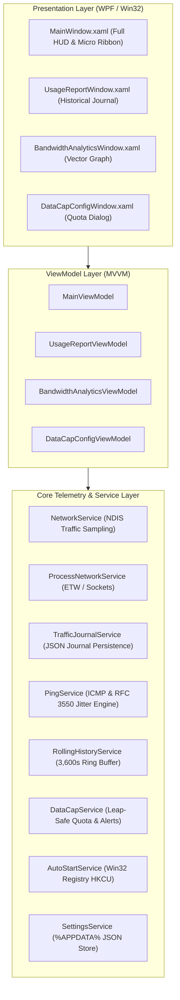

# InternetMeter 🌐⚡

> **A high-performance, frosted glass desktop network telemetry widget for Windows 10 & 11.**  
> Engineered with **.NET 8 (WPF)**, hardware-accelerated **Win32 DWM Acrylic**, real-time NDIS throughput sampling, RFC 3550 gaming jitter diagnostics, and per-process traffic attribution.

[-0078D6?logo=windows&logoColor=white)](https://microsoft.com)
[-512BD4?logo=dotnet&logoColor=white)](https://dotnet.microsoft.com/)
[](Tests/)
[](LICENSE)
[]()

---

## 📸 Overview & Visual Modes

InternetMeter lives unobtrusively on your desktop as an elegant floating HUD or ultra-compact ribbon, displaying microsecond-accurate physical network throughput, gaming health diagnostics, and per-app bandwidth usage.

```
┌────────────────────────────────────────────────────────┐
│  ● All Sources       ● 18 ms       📌   [MB/s]   ✕   │
├────────────────────────────────────────────────────────┤
│  ↓ 14.82 MB/s   ╱╲╱╲╱╲_                                │
│  ↑  2.15 MB/s   ~/\~/\~~                               │
├────────────────────────────────────────────────────────┤
│  42.6 GB / 100.0 GB (42.6%)             18 days left   │
│  [=====================>                             ] │
├────────────────────────────────────────────────────────┤
│  Session: ↓ 1.42 GB  ↑ 280 MB               ▲ Apps (4) │
│  ┌──────────────────────────────────────────────────┐  │
│  │ [Live] Total                           ↗ Report  │  │
│  │  🌐 brave.exe                ↓ 12.40  ↑ 0.12 MB/s│  │
│  │  🎮 steam.exe                ↓  2.10  ↑ 0.05 MB/s│  │
│  │  💬 discord.exe              ↓  0.18  ↑ 0.08 MB/s│  │
│  │  🎧 spotify.exe              ↓  0.14  ↑ 0.01 MB/s│  │
│  └──────────────────────────────────────────────────┘  │
└────────────────────────────────────────────────────────┘
```

---

## ✨ Flagship Capabilities

### 1. 🎮 Gaming & VoIP Network Health Monitor
Transforms the classic ping indicator into a live competitive gaming diagnostic suite:
- **RFC 3550 Interarrival Jitter Smoothing**: Calculates packet delay variance in real-time:
  $$J_i = J_{i-1} + \frac{|D(i-1, i)| - J_{i-1}}{16}$$
- **Rolling Packet Loss Tracker**: 20-sample sliding window calculating drop percentages ($0.0\%$ to $100\%$).
- **Bufferbloat Early Warning Engine**: Detects queue saturation under heavy traffic loads ($\ge 2.5\text{ MB/s}$), badging ping spikes directly on the HUD (`⚠ Bufferbloat`).
- **Composite Quality Grading**: Automatic benchmark grades (**A+ Esports Ready**, **A**, **B**, **C**, **D**, **F**).
- **Interactive Flyout Card**: Single-click on the ping badge reveals a frosted glass telemetry diagnostic flyout.

### 2. 📊 Monthly Data Cap & Hotspot Quota Alerts
Ideal for metered broadband, cellular 4G/5G hotspots, and remote work tethering:
- **Leap-Safe Billing Cycles**: Automatically calculates cycle boundaries handling months with 28, 29, 30, or 31 days and leap years.
- **HUD Glass Progress Gauge**: Frosted progress bar with dynamic threshold coloring (Emerald `#10B981` $\to$ Amber `#F59E0B` $\to$ Crimson `#EF4444`).
- **Tiered Action Center Toast Notifications**: Dispatches native Windows balloon notifications at Warning ($80\%$), Critical ($95\%$), and Exceeded ($100\%$) consumption thresholds with single-fire deduplication.
- **Dedicated Configuration Modal**: Quick presets (`25 GB` to `2 TB`), reset day slider ($1 - 31$), and live cycle date calculation preview.

### 3. 📈 Rolling 60-Minute Detailed Bandwidth Analytics Window
Dedicated high-resolution vector visualization window (`Ctrl+Shift+A`):
- **Continuous Ring Buffer**: Up to 3,600 samples recorded at 1Hz ($< 1.5\text{ MB}$ memory footprint).
- **Multi-Resolution Timeframes**: Switch smoothly between `15 Minutes`, `30 Minutes`, and `60 Minutes`.
- **Interactive Crosshair Scrubber**: Hover over the graph to inspect exact throughput, timestamps, and the top transmitting application active at that precise second.
- **Hero Metrics**: Peak download throughput, peak upload throughput, total moved volume, and average rates.
- **Instant CSV Export**: One-click RFC 4180 CSV export dumped directly to Downloads folder.

### 4. 🔍 Process Network Inspector & Historical Journal
- **Top Transmitting Applications**: Real-time per-process socket attribution showing the top 4 or top 8 data hogs with native process executable icons.
- **Live vs Cumulative Toggles**: Toggle between instantaneous throughput (`MB/s`) and cumulative session transfer (`MB/GB`).
- **Traffic Usage Report Window (`Ctrl+Shift+R`)**: Searchable historical journal with timeframe filtering (`Today`, `Last 7 Days`, `Last 30 Days`, `This Year`, `All Time`), sorting, and CSV export.

### 5. 🎨 Designer Themes & Windows 11 Acrylic Blur
- **Four Curated Palettes**:
  - **Emerald & Sky (Default)**: `#10B981` download $\downarrow$ with `#38BDF8` upload $\uparrow$ on deep `#0D0F18` OLED slate.
  - **Cyberpunk Neon**: Electric `#F43F5E` (Hot Magenta $\downarrow$) and `#06B6D4` (Cyan $\uparrow$).
  - **Monochrome Stealth**: Crisp `#F8FAFC` typography with muted `#64748B` slate accents.
  - **Solar Amber**: Warm `#F59E0B` (Amber $\downarrow$) and `#EAB308` (Gold $\uparrow$) blue-light reduction setup.
- **Native DWM Backdrop Blur**: Hardware-accelerated Windows 11 Acrylic (`DWMSBT_TRANSIENTWINDOW`) blurring desktop wallpaper and background windows.
- **Proportional UI Scaling**: Scales proportionally across high-DPI displays:
  - `85% (Compact)` ($232.9\text{ px}$ width)
  - `100% (Standard)` ($274.0\text{ px}$ width)
  - `125% (Large)` ($342.5\text{ px}$ width)

### 6. 👻 Ghost Mode & Screen Edge Snapping
- **Click-Through Ghost Mode (`Ctrl+Shift+G`)**: Passes mouse clicks cleanly through to underlying full-screen games, IDEs, and browsers.
- **Screen Edge Magnetic Snapping**: Snaps to monitor edges and sits cleanly above the Windows Taskbar within working area boundaries.
- **Compact Micro Ribbon Mode (`Ctrl+Shift+D`)**: Collapses down to an ultra-thin 20px horizontal status pill.

---

## ⌨️ Global Keyboard Shortcuts

| Shortcut | Action | Description |
|---|---|---|
| <kbd>Ctrl</kbd> + <kbd>Shift</kbd> + <kbd>D</kbd> | **Toggle Compact Ribbon** | Switch between Full HUD and 20px Micro Ribbon |
| <kbd>Ctrl</kbd> + <kbd>Shift</kbd> + <kbd>G</kbd> | **Toggle Ghost Mode** | Enable/disable click-through transparency |
| <kbd>Ctrl</kbd> + <kbd>Shift</kbd> + <kbd>P</kbd> | **Toggle Process Inspector** | Expand/collapse the top applications panel |
| <kbd>Ctrl</kbd> + <kbd>Shift</kbd> + <kbd>R</kbd> | **Traffic Usage Report** | Summon the historical traffic journal window |
| <kbd>Ctrl</kbd> + <kbd>Shift</kbd> + <kbd>A</kbd> | **Bandwidth Analytics** | Open the 60-minute rolling vector graph window |

---

## 🛠️ Architecture & Tech Stack



- **Runtime**: [.NET 8.0-windows](https://dotnet.microsoft.com/download/dotnet/8.0)
- **Framework**: Windows Presentation Foundation (WPF) with Win32 DWM interop
- **Testing**: xUnit with 106 automated tests in [`Tests/`](Tests/)
- **Zero Third-Party NuGets**: Clean, self-contained architecture with minimal memory footprint ($< 25\text{ MB}$ resting RAM).

---

## 🚀 Building & Running

### Prerequisites
- Windows 10 (Build 19041+) or Windows 11
- [.NET 8.0 SDK](https://dotnet.microsoft.com/download/dotnet/8.0)

### Clone & Build
```powershell
# Clone the repository
git clone https://github.com/YourUsername/InternetMeter.git
cd InternetMeter

# Restore dependencies & compile
dotnet build -c Release

# Run automated tests
dotnet test Tests/InternetMeter.Tests.csproj

# Publish self-contained or framework-dependent release executable
dotnet publish InternetMeter.csproj -c Release -r win-x64 --self-contained false -o publish
```

The compiled binary will be placed at `publish/InternetMeter.exe`.

---

## 📁 Configuration & Data Storage

All user configurations and persistent historical traffic logs are stored in:
```
%APPDATA%\InternetMeter\
├── settings.json         # User preferences, themes, scale, data cap, hotkeys
└── usage_history.json    # Daily aggregated traffic journal by process
```

---

## 📄 License

This project is licensed under the [MIT License](LICENSE).

